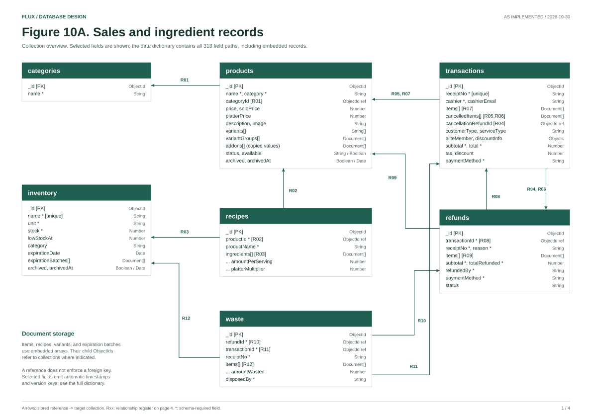
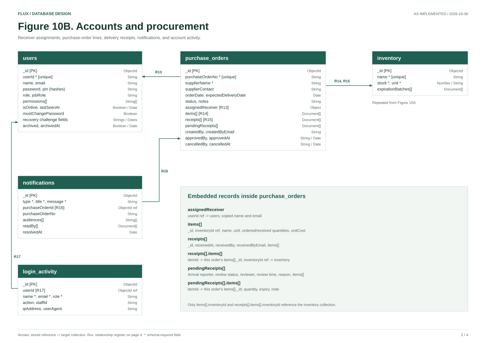
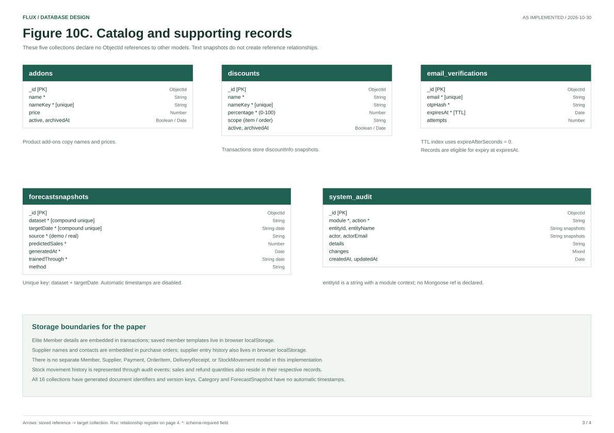

# Figure 10. FLUX Database Schema

As implemented on 2026-10-30. This document describes the current application model definitions, rather than a proposed SQL redesign. The schema consists of **16 MongoDB collections, 318 field paths including embedded records, and 17 declared ObjectId references**.

## Deliverables

- [Printable four-page schema PDF](../output/pdf/FLUX_Database_Schema.pdf)
- [Figure 10A: sales and ingredient records (SVG)](database_schema_core.svg)
- [Figure 10B: accounts and procurement (SVG)](database_schema_operations.svg)
- [Figure 10C: catalog and supporting records (SVG)](database_schema_support.svg)
- [Relationship register (SVG)](database_schema_relationships.svg)
- [Full data dictionary](Data_Dictionary.md)
- [Relationship register with exact field paths](Database_Relationships.md)
- [Editable Mermaid ER diagram source](database_schema.mmd)
- [Machine-readable schema snapshot](database_schema.json)

## Manuscript discussion

Figure 10 presents the database structure of FLUX, a Point-of-Sale and Inventory Management System for Eli Coffee and Tea Cafe. MongoDB stores the system's accounts, menu configuration, ingredient inventory, recipes, sales transactions, refunds, waste records, purchase orders, notifications, and supporting operational records. Mongoose schemas define document fields, data types, validation rules, defaults, indexes, and application-level references.

The design combines referenced collections with embedded documents. Products may reference categories, recipes link products to inventory ingredients, and transaction items retain product references alongside copied sale details. Refunds reference their original transactions, while waste records reference refunds, transactions, and affected ingredients. Purchase orders embed ordered items, receiving records, and delivery approval records; their ObjectId fields can reference inventory and an assigned user. Embedded item snapshots preserve the values recorded for an operation even when master records later change.

The diagram is divided into three figures for legibility. Figure 10A covers sales and ingredient records; Figure 10B covers accounts and procurement; Figure 10C covers master add-ons, discounts, email verification, forecast snapshots, and audit records. The accompanying relationship register lists every declared ObjectId reference. The Inventory collection is repeated in Figure 10B to show procurement links; it remains one collection.

## Figure 10A. Sales and ingredient records



## Figure 10B. Accounts and procurement



## Figure 10C. Catalog and supporting records



## Notation and scope

- `_id [PK]` identifies a top-level document. Mongoose supplies ObjectId identifiers; embedded subdocuments also normally receive local `_id` values.
- `*` means schema-required. Required fields inside an array are conditional on the containing element existing. Other application/API rules may add validation beyond the model declaration.
- `[]` means an embedded array, not a collection or relational join table.
- An arrow points from a stored ObjectId reference to its target collection. R01-R17 correspond to [Database_Relationships.md](Database_Relationships.md).
- The Mermaid source uses `FK` as a visual marker for reference attributes. These are not SQL foreign keys, and MongoDB does not enforce the existence of referenced documents from Mongoose `ref` declarations.
- Mermaid attribute types `StringArray`, `NumberArray`, and `DocumentArray` denote the corresponding arrays; `StringMap` denotes a string-valued map. Exact Mongoose types appear in the dictionary.
- In the Mermaid source, a single required reference has an intended one-target association; a single optional reference has a zero-or-one target association. Array references permit multiple targets. These describe model structure, not verified target existence.
- Names and emails stored as snapshots are not drawn as reference relationships. In particular, transaction cashier emails, audit actor emails, supplier contacts, and notification read receipts do not declare User or Supplier ObjectId references.
- The PDF diagrams select key attributes. [Data_Dictionary.md](Data_Dictionary.md) lists all field paths, data types, required flags, defaults, validation rules, and declared indexes.
- The schema includes status values retained by the models, even where the current interface exposes only part of that lifecycle.

## Storage boundaries and fidelity notes

1. **Members:** Transaction documents embed `eliteMember.name` and `eliteMember.idNumber`. Saved member templates use browser `localStorage` (`flux.eliteMemberHistory`); there is no Member collection. The 1-12 digit card rule is in [checkout middleware](../backend/middleware/validateEliteMember.js), not a field-level Mongoose validator.
2. **Suppliers:** Purchase orders embed supplier names and contacts. The reusable supplier history is browser `localStorage` (`flux.purchaseOrderSupplierHistory`); there is no Supplier collection.
3. **Items and payments:** Transaction items, cancellation items, variant choices, and upgrades are embedded. Payment details are transaction fields. No separate OrderItem or Payment collection exists.
4. **Receiving:** Purchase-order items, receipts, pending receipts, and their line items are embedded. `receipts[].items[].itemId` and `pendingReceipts[].items[].itemId` refer to an ordered line's local `_id` in that same purchase order, without a Mongoose `ref`.
5. **Stock records:** Inventory stores current quantities and expiration batches. Stock-in and stock-out activity is logged through SystemAudit events; no dedicated StockMovement model exists.
6. **Uniqueness:** The declared indexes include unique keys on user business IDs, transaction receipt numbers, inventory names, add-on/discount name keys, purchase-order numbers, verification emails, and forecast dataset/date pairs. There is no declared unique index on `users.email`, `categories.name`, or `recipes.productId`. The application may add business checks; this document does not invent database constraints.
7. **Timestamps:** Category and ForecastSnapshot do not enable Mongoose automatic timestamps. ForecastSnapshot explicitly stores `generatedAt`. The remaining 14 models enable `createdAt` and `updatedAt`.
8. **Implementation boundary:** This export reads only `backend/models/*.js`, plus the cited application storage rules. It does not read operational records, connect to MongoDB, change the database, or confirm which indexes are deployed. Legacy models declared only inside seed scripts are excluded from the active model inventory.

## Regenerate from the implementation

From the repository root, export the model metadata and dictionary:

```powershell
node backend/scripts/exportDatabaseSchema.js --as-of 2026-10-30
```

To render the printable figures after updating the selected-field layouts in the renderer:

```powershell
python -m pip install reportlab
python docs/scripts/render_database_schema.py
```

For optional visual QA, install `pymupdf` and run:

```powershell
python docs/scripts/render_database_schema.py --preview
```

The renderer writes the PDF under `output/pdf`, SVGs under `docs`, and temporary PNG previews under `tmp/pdfs`. When changing the model set or key fields, review figure layouts, collection counts, field counts, and reference IDs together with the regenerated snapshot.
